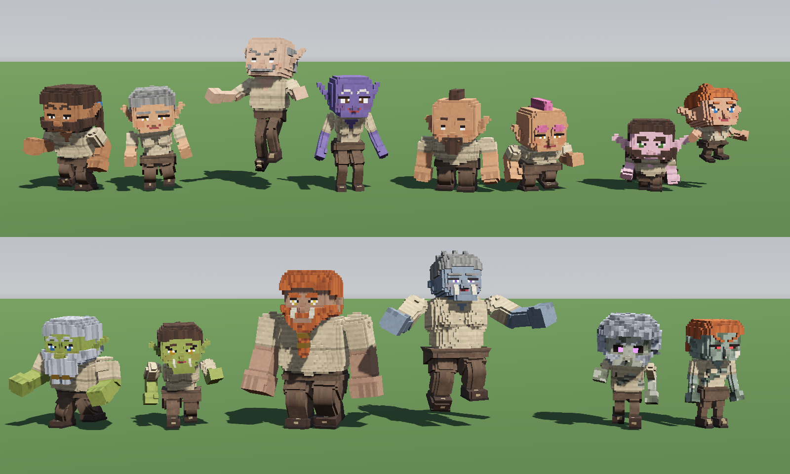
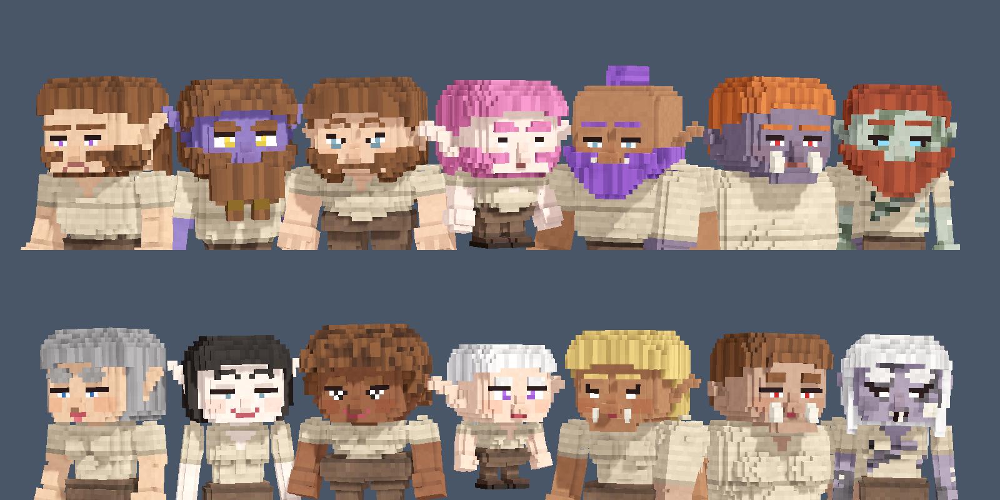
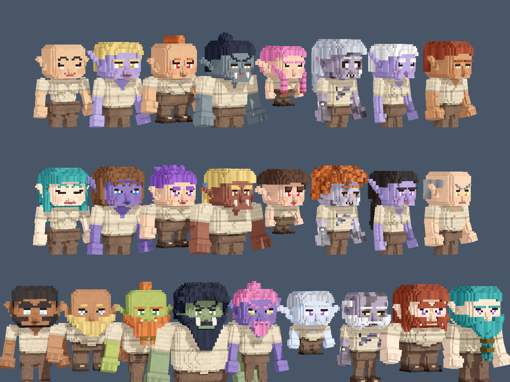
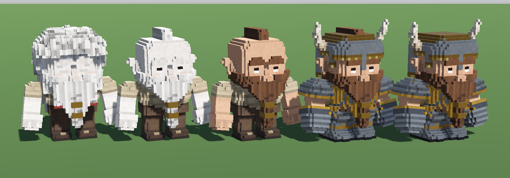
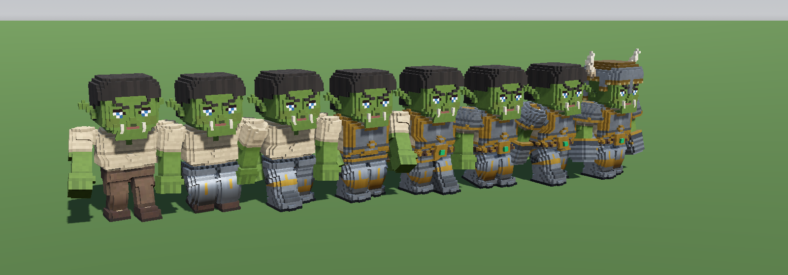
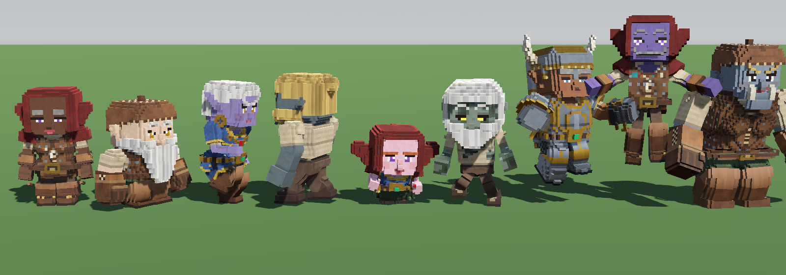
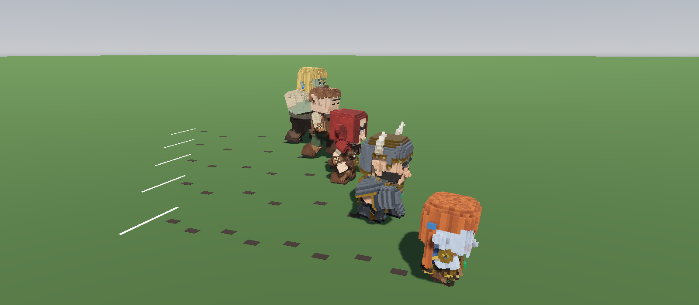

# Voxel Model Generator

Seven fantasy races, fourteen bodies, one glorious charge.


This is a voxel character generator in plain Python, with no dependencies. It builds the
characters of Tideweald:

- **Bodies.** Human, dwarf, elf, gnome, orc, ogre and undead, each with a man's and a woman's
  body.
- **Faces in pieces.** Seven each of eyes, brows, noses and mouths.
- **Hair and beards.** 16 hair styles and 10 beards.
- **Gear.** 22 items that fit every body.
- **Animation.** Rigged and animated, with walks and runs whose planted feet stay planted.

Everything comes out as glTF binaries (`.glb`) that load in any engine.

Nothing is modelled by hand. Every shape is a signed-distance sculpt, filled voxel by voxel. Every
voxel is shaded on its own, with per-voxel colour jitter and ambient occlusion baked into the
vertex colours. The result looks hand-painted, and there isn't a texture in sight.

## Quick start

You need Python 3.10 or newer. Nothing else.

```sh
python build.py                         # every body and every item
python build.py hood gold_band          # every body, and only these items
python build.py --body elf_female       # only this body (again for more)
python build.py --no-gear               # the bodies only
python build.py --out ~/my-game/        # somewhere else
python gait.py                          # how fast each body's gaits go, and that nothing skates
```

A full build takes under a minute. It writes a folder for each body into `models/` beside
`build.py`. Each folder is named `<race>_<sex>`, such as `orc_female`:

| File                            | What's in it                                                                 |
| ------------------------------- | ---------------------------------------------------------------------------- |
| `models/<body>/body.glb`        | The armature, every part of the body, the face's pieces, hair, beards, clips |
| `models/<body>/gear/<item>.glb` | One item of gear, built on that body and skinned to the same armature        |

Open a `.glb` in Blender (File › Import › glTF 2.0) to look around. It comes in as an armature with
its meshes parented and weighted, and the clips appear as actions.

In this repo the game's copy of the models (`client/godot/assets/models/characters/`) is committed
through Git LFS. The `.gitattributes` at the root routes every `.glb` there, so a rebuild needs only
`git add`. Clone with Git LFS installed, or run `git lfs install --local && git lfs pull`
afterwards. Without it the `.glb` files are small pointer files that won't load. `models/` here is
ignored.

## The races



| Race   | Height | The man                                                                                 |
| ------ | ------ | --------------------------------------------------------------------------------------- |
| human  | 1.8 m  | Stocky. The head is two fifths of him.                                                  |
| dwarf  | 1.5 m  | Nearly as wide as he is tall: barrel chest, belly, thick arms, short heavy legs, big lobed ears |
| elf    | 2.1 m  | Slim and long in the leg, with ears swept up and back                                   |
| gnome  | 1.2 m  | Half of him is head: a tiny body, with big ears out to the sides                        |
| orc    | 1.95 m | Broad and muscled, with the head thrust forward, an underbite with tusks, and ears cocked back |
| ogre   | 2.5 m  | Huge: a great gut, massive arms, a small head hunched low, a heavy jaw and great tusks  |
| undead | 1.76 m | Gaunt: thin limbs, a sunken belly, hollow eyes, blotched skin, a ragged shirt, and bone showing through the cheek and forearms |

Every race's woman, compared with its man:

- a narrower chest and shoulders
- a waist and wider hips
- a bust
- slimmer arms and legs
- smaller hands and feet

The game also draws her 6% shorter. Women have no beards.

## Faces, hair and beards



A face is four meshes, chosen separately, set over a skull. The skull leaves a patch for the eyes
and another for the mouth, and every eye and mouth style fills its patch. Brows and noses stand
proud of the skull, so any four pieces go together. The races add their own touches in the skull
itself: tusks and a jutting jaw for orcs and ogres, bare bone for the undead. The undead's irises
glow in the game.

| Mesh            | Styles                                                                                       |
| --------------- | -------------------------------------------------------------------------------------------- |
| `eyes_<style>`  | `round`, `narrow`, `wide`, `small`, `fierce`, `sleepy`, `almond` (on a woman, with lashes)   |
| `brows_<style>` | `heavy`, `thin`, `arched`, `low`, `angry`, `bushy`, `short`                                  |
| `nose_<style>`  | `broad`, `small`, `button`, `long`, `hooked`, `flat`, `bulbous`                              |
| `mouth_<style>` | `wide`, `full`, `thin`, `smile`, `frown`, `small`, `pout` (on a woman, redder)               |



| Mesh            | Styles                                                                                       |
| --------------- | -------------------------------------------------------------------------------------------- |
| `hair_<style>`  | `crop`, `mohawk`, `topknot`, `braids`, `mane`, `ponytail`, `bun`, `long`, `bob`, `spiky`, `pigtails`, `sidecut`, `curly`, `dreadlocks`, `tonsure`, and `bald` (no mesh) |
| `beard_<style>` | `stubble`, `full`, `forked`, `long`, `goatee`, `moustache`, `chops`, `short`, `braided`, and `none` (no mesh). Men's bodies only. |

Hair hangs from the `head` bone, so a ponytail swings with the head and not the chest. Beards and
braids hang 8 voxels in front of the chest, which keeps them clear of anything worn there.

## Putting a character together



Everything in `body.glb` and every gear file is skinned to the same 20-bone armature, in the same
joint order. A character is one skeleton with meshes switched on and off, plus any gear meshes
bound to that same skeleton:

1. **Load `body.glb`** and keep its skeleton and its clips.
2. **Show one of each:** `eyes_<style>`, `brows_<style>`, `nose_<style>`, `mouth_<style>`,
   `hair_<style>` and `beard_<style>`. Hide the rest. `head_skull` and the `body_<part>` meshes are
   always shown unless gear hides them.
3. **Tint.** The `skin`, `hair` and `iris` materials are drawn near white, holding shading only.
   Set each material's base colour to the character's skin, hair or eye colour, using a copy of the
   material per character. Brows and beards use `hair` too.
4. **Put on gear.** Load the body's own `gear/<item>.glb` and bind its meshes to the body's
   skeleton. It's the same armature, so the meshes go straight on.
5. **Hide what the gear covers** (see the table under [Gear](#gear)), so nothing pokes through.
6. **Rings** have a mesh for each hand (`<id>_L`, `<id>_R`). Show the one for the hand the ring is on.

The models keep all their colour in their vertex colours, so the materials must draw them.
three.js's `GLTFLoader` does this by itself. Godot 4.7's glTF importer leaves the vertex-colour
flag off on the first primitive of each file, so turn `vertex_color_use_as_albedo` on yourself.

| Mesh          | What it is                                                                       |
| ------------- | -------------------------------------------------------------------------------- |
| `body_<part>` | `torso`, `upper_arms`, `forearms`, `hands`, `hips`, `legs`, `feet`, `ears`       |
| `head_skull`  | The skull, with holes for the eyes and mouth, plus what the race adds            |

Each mesh's node also carries its name in its extras, as `part`. Under any gear, every body wears an
undyed linen shirt, wool trousers and leather shoes.

There are seven materials:

- `cloth`, `leather`, `metal` and `gloss` keep their own colours.
- `skin`, `hair` and `iris` are tinted.
- The undead's bare bone and teeth are `gloss`, so they stay bone-coloured whatever the skin.

## Gear



| Slot                | Items                                      | Hides or covers                          |
| ------------------- | ------------------------------------------ | ---------------------------------------- |
| Head                | Leather cap, horned helm                   | Hides the hair                           |
| Head                | Woollen hood                               | Hides the hair and ears; covers earrings |
| Neck                | Gold amulet, bead necklace                 |                                          |
| Chest               | Linen tunic, leather jerkin, steel cuirass |                                          |
| Arms                | Leather bracers, steel pauldrons           |                                          |
| Gloves              | Leather gloves, plate gauntlets            | Hides the hands; covers rings            |
| Belt                | Leather belt, gilded belt                  |                                          |
| Legs                | Wool trousers, plated tassets              |                                          |
| Feet                | Leather boots, iron sabatons               | Hides the feet                           |
| Ears                | Gold hoops, gem studs                      |                                          |
| Rings (either hand) | Gold band, ruby ring                       |                                          |

The ids are the names in snake case: `horned_helm`, `gold_belt` for the gilded belt, and `hood`
for the woollen hood. They're listed with their slots in `defs.py`.

Each piece is built out from the surface of the body parts it covers, in a band a set number of
voxels deep, then shaped and painted. Pieces that cover the same part are layered by depth, so
whichever are worn together, the outer one covers the inner one where they meet:

| Piece                                     | Depth (voxels)         |
| ----------------------------------------- | ---------------------- |
| Trousers, shirts, tunics, bracers, gloves | 1½                     |
| Skirt over the trousers                   | 2½                     |
| Cuirass, necklace                         | 2                      |
| Pauldrons, belt                           | 3                      |
| Boots                                     | 1½, and 2½ up the shin |

Gear is built for each body separately, so use the files from that body's own folder: a man's
boots won't fit an elf woman. Slim bodies get slim armour, and an ogre's cuirass is a
blacksmith's week.

## Clips



The clips are keyed in code (`clips.py`), one pose per moment, and sampled 30 times a second with
linear interpolation. Idle, jump, fall and land are hand-keyed poses. The gaits are built from
where the feet go:

1. Each foot plants on the ground.
2. While it's down, it slides back under the body at exactly the gait's speed.
3. Then it lifts and swings forward to plant again.
4. Two-bone IK bends that body's own thigh and shin to reach it.

| Clip                          | Human cycle | Loops | Ground speed                                  |
| ----------------------------- | ----------- | ----- | --------------------------------------------- |
| `idle`                        | 3 s         | yes   |                                               |
| `walk`                        | 0.85 s      | yes   | 0.3–0.65 m/s (as far as the legs reach)       |
| `run`                         | 0.42 s      | yes   | 4.5 m/s                                       |
| `backpedal`                   | 0.56 s      | yes   | 2.6 m/s                                       |
| `strafe_left`, `strafe_right` | 0.42 s      | yes   | 2.8 m/s (side-stepping; the feet never cross) |
| `jump`                        | 0.35 s      | no    |                                               |
| `fall`                        | 0.8 s       | yes   |                                               |
| `land`                        | 0.3 s       | no    |                                               |

glTF doesn't say whether a clip loops, so set that from this table. In a looping gait the left foot
comes down at 0 and the right at 0.5, which is where to play footsteps.

### No skating



Every body runs at the same 4.5 m/s. A gait's cycle scales with the square root of the leg's
length, so short legs simply step faster: a gnome's run cycle is 0.28 s, a human's 0.42 s and an
elf's 0.58 s. Where a short leg can't reach far enough, the body flies further between steps.

The race above is drawn the way an engine plays it: each runner moves at 4.5 m/s, playing its run,
and leaves a print wherever a foot is down. A planted foot that slid would smear its print into a
streak, and every print here is crisp.

To play a gait without skating:

- **Set the playback rate** to the character's speed ÷ the clip's ground speed.
- **If you draw the model bigger,** divide by its scale too, since it strides further.
- **Don't widen the hips or legs by scaling their bones** in the engine. A bone's scale stretches
  how its children turn, which lengthens the stride and sets the feet skating. Widening the trunk
  and arms is fine.

`gait.py` measures every body's ground speeds from the built models. It poses the armature through
each clip with forward kinematics, the way an engine does, and checks that a planted foot never
slips. `python gait.py --rust PATH` writes the table out as Rust for the game.

## Size and skeleton

A voxel is 3.75 cm on every body, so the 48-voxel human is 1.8 m and the 66-voxel ogre is 2.5 m.
Each body stands on the origin and faces +z, with its left at +x. The human's landmarks, in voxels
up from the soles:

| Part                        | Voxels (y)          |
| --------------------------- | ------------------- |
| Head, with hair             | 30–48, 18 wide      |
| Neck                        | 29                  |
| Chest                       | 22–29               |
| Belly                       | 17–22               |
| Hips                        | 13–17               |
| Thighs, shins, feet         | 8–13, 4–8, 0–4      |
| Upper arms, forearms, hands | 21–29, 15–21, 10–15 |

Every other body's landmarks are in its spec in `races.py`. The bones are named in Blender's
Rigify style, so poses mirror in Blender:

```
root ─ hips ─┬─ spine ─ chest ─┬─ neck ─ head
             │                 ├─ shoulder_L ─ upper_arm_L ─ forearm_L ─ hand_L
             │                 └─ shoulder_R ─ upper_arm_R ─ forearm_R ─ hand_R
             ├─ thigh_L ─ shin_L ─ foot_L
             └─ thigh_R ─ shin_R ─ foot_R
```

The bones aren't rotated in the bind pose, so any rotation in a clip is about the character's own
axes. Every body has the same 20 bones, with the same names and parents; only where the joints sit
changes. Anything that drives the skeleton by bone name works on all of them, so switching a
character's race or sex is just a change of folder.

**Weights.** The space around the body is divided among the bones where the body bends (`bone_at`
in `rig.py`), and each voxel moves with the bone whose space it's in. A vertex on a joint is shared
half and half with the next bone, so knees and elbows bend without opening. Bones that aren't
joined never share a vertex. Gear is weighted by the same division of space, so it bends with the
body under it.

## The code

| File        | What it does                                                                                |
| ----------- | ------------------------------------------------------------------------------------------- |
| `build.py`  | Builds the models (the command line)                                                        |
| `defs.py`   | Bones, body parts, items and slots, face, hair and beard styles                             |
| `voxels.py` | The voxel grid, signed-distance shapes, shells, noise and paint                             |
| `races.py`  | Each body's proportions: joints, landmarks, part sizes, ears, face rows, what the race adds |
| `body.py`   | The body, the face's pieces, hair and beards                                                |
| `gear.py`   | Every item of gear                                                                          |
| `rig.py`    | The joints, which bone moves which voxel, and the skin weights                              |
| `mesh.py`   | Voxels to quads: open faces only, baked AO, weights                                         |
| `clips.py`  | The animations, with the gaits built by IK from the feet's paths                            |
| `gait.py`   | Measures how fast each body's gaits go, and that the planted foot never slips               |
| `gltf.py`   | A small `.glb` writer and reader                                                            |
| `verify.py` | Compares two sets of models, value by value                                                 |

## Customising

Everything is built from three places:

- each body's spec in `races.py`
- the code in `body.py` and `gear.py`
- the lists in `defs.py`

The code reads the body being built through `races.current()`, which `build.py` sets for each
`--body`. Nothing measures a body by hand. A hem, a cuff or a belt is placed from the body's
landmarks, so it lands in the right place on a gnome and on an ogre alike.

### Palettes

There are three kinds of colour:

- **Tinted materials.** `skin`, `hair` and `iris` are drawn near white and tinted in the engine
  (see [Putting a character together](#putting-a-character-together)). The defaults a viewer shows
  before tinting are in `MATERIALS` in `mesh.py`. The game's palettes are in its shared crate: each
  race's skin tones in `shared/src/appearance.rs`, and the hair and eye colours in
  `shared/src/character.rs`.
- **Underclothes and faces.** The linen shirt, wool trousers, shoes, lips and lids are constants at
  the top of `body.py`: `LINEN`, `WOOL`, `SHOE`, `LIP`, `LIP_F` and `DARK`.
- **Gear.** The shared metals and stones are constants at the top of `gear.py`: `IRON`, `GOLD`,
  `BRASS`, `RUBY` and so on. Each item's own colours are in its function as `0xRRGGBB`, passed to
  `cloth`, `leather` or `metal`, which add the per-voxel noise and jitter. Change a colour and
  rebuild; nothing else depends on it.

### Hair, beards and faces

1. Add the style's name to the end of its list in `defs.py` (`HAIR_STYLES`, `BEARD_STYLES`,
   `EYE_STYLES` and so on). A game stores styles by their place in the list, so only ever append.
   Keep the game's copy in `shared/src/character.rs` in step.
2. Add a branch for it to `hair_grid`, `beard_grid`, `eyes_grid`, `brows_grid`, `nose_grid` or
   `mouth_grid` in `body.py`. Some useful pieces:
   - `cap(thick, where)` grows a layer of hair over the scalp. `scalp` says where hair grows
     (hairline, nape, clear of the ears), and you can pass your own `where`.
   - `fill` with `strand_down` or `strand_back` adds a shape painted as strands.
   - Give anything that hangs below the head the `head` bone, as `strand` does.
3. Place things from the body, never with bare numbers. Start with `r = current()`, then use
   `r.head_top`, `r.back` (the back of the skull), `r.eye_row`, `r.mouth_row` and `r.front` (the
   face's front layer). A beard's length is counted down from the mouth.
4. Build with `--no-gear` and look at it on a gnome, an ogre and a woman.

### Gear

1. Add it to `ITEMS` in `defs.py`, with its slot and anything it hides or covers.
2. Write its sculpt in `GEAR` in `gear.py`. `band` grows a layer out from parts of the body,
   `fill` adds a shape, and `trim` recolours edges. Look at a similar item first.
3. Start and stop it at the body's landmarks (`r.wrist + 1`, `r.knee - 1`, `r.belt`), not at fixed
   rows. Rows and columns are whole numbers, so round a fractional landmark with `math.floor` before
   using it as a cell. For something on the right-hand side, use `mirror_x(x)` on the left's column.
4. Run `python build.py <id>` to build it on every body, then look at it on a gnome and an ogre.

### Writing a race

A body is a `Race` in `races.py`, named `<race>_<sex>`. Add it to `BODIES` and build it with
`--body <name>`. Its models go to `<out>/<name>/`. The quickest start is a variant of one that
exists. That's how each race's woman is made: she is the race's man with some fields replaced.

```python
# The human man with a bigger belly and longer ears.
STOUT = replace(HUMAN, name="stout_male", race="stout", belly_radii=(8.8, 6.4, 6.6), belly_z=1, ear_tip=(4, 6, -1)).check()
```

All values are in voxels, with y up from the soles. `check()` raises an error if the landmarks are
out of order.

| Fields | What they set |
| ------ | ------------- |
| `height` | The whole height to the top of the hair. A voxel is 3.75 cm for every body, so a 56-voxel elf is 2.1 m. |
| `sole`, `ankle`, `knee`, `hip` | The leg's joints: foot, shin and thigh. |
| `belt`, `waist`, `belly`, `chest` | The hips' joint and the belt's lower row; where the hips end and the belly begins (the shirt's hem); the middle of the belly; and the chest's joint. |
| `shoulder`, `elbow`, `wrist` | The arm's joints. The hand hangs below the wrist. |
| `neck`, `head_bottom`, `head_top` | The neck's joint, and the skull's bottom and top. The skull spans the two. |
| `leg_x`, `arm_in`, `arm_x`, `leg_z` | How far out the legs' middle is; where the arms begin (anything this far out below the head moves with an arm, so keep the hips inside it); the arms' middle; and how far back the hips and legs sit. |
| `*_half`, `*_round`, `*_radii`, `*_z`, `*_at` | Each part's half-width and half-depth (and half-height where it doesn't run joint to joint), its rounding, and where it's placed. The torso, legs and arms run joint to joint, so their length comes from the landmarks. |
| `waist_half` | The torso's half-width below the chest, if it's narrower there (a woman's waist). |
| `ear_root`, `ear_tip`, `lobe`, `lobe_end`, `*_radius`, `ear_fold` | Two capsules for each ear, placed from the side of the skull at the eyes' row. |
| `eye_row`, `nose_row`, `mouth_row` | The face's rows: the nose one row over the mouth, the eyes three rows over the nose. The brows, lashes, cheeks, hairline, cap, helm and beard follow them. |
| `race`, `sex` | Which race this is, and which of its bodies. |
| `bust`, `bust_at` | Each breast's radii, and where it sits (out, row, forward). |
| `tusks`, `jaw` | Tusks from the lower jaw (1 for an orc's, 2 for an ogre's), and how far the jaw juts past the lip. |
| `hollow_eyes`, `decay` | Dark sockets behind the whites of the eyes; blotched skin, bare bone and a ragged shirt. |

Some landmarks are worked out from the others: `front` (the face's front layer), `back`,
`chest_front` (where a pendant hangs, in front of any bust), `shoulder_cap`, `sleeve`, and
`down_thigh(t)` for skirt hems. If a body needs one of these somewhere else, turn it into a field.

The faces are drawn at fixed columns (the eyes 2 to 4 out from the middle), so keep the head about
18 voxels wide. A big race then gets a small-looking head, which suits an ogre. After adding a body,
run `gait.py` to see its gaits' speeds, and write the table out again for the game.

## Checking a build

`verify.py` compares two sets of models part by part, all as stored: positions, normals, colours,
joints, weights, triangles, materials, the armature and every clip key. Use it to make sure a
refactor changed nothing:

```sh
python build.py --out before/
# ...change the code...
python build.py --out after/
python verify.py before/ after/
```

It compares every body folder in the first set with the one of the same name in the second.

The generator is a port of from the author's original TypeScript one, and it sculpts the human man's body the same,
voxel for voxel: his `body_<part>` meshes come out identical. The faces, the other bodies and the gaits are new.

It also draws a few faces of the voxels that the original left out. The original hid any face that
touched a filled cell, even where the two cells move with different limbs, such as the two feet, or
a glove against the hip. When those limbs moved apart there was nothing there, and you could see
into the model. Now a face is hidden only against a cell that moves with it (`moves_with` in
`mesh.py`).

To keep the voxels the same, the code copies a few JavaScript number rules on purpose, because ties
and rounding decide single voxels:

- `js_hypot` is V8's `Math.hypot`, which differs from Python's in the last bit.
- `js_round` rounds halves up, like `Math.round`.
- `imul` is a 32-bit multiply.
- Grids keep their cells in insertion order, like a JS `Map`.

## License

Copyright (C) 2026 Zachary Jones

This program is free software: you can redistribute it and/or modify it under the terms of the GNU
General Public License as published by the Free Software Foundation, either version 3 of the
License, or (at your option) any later version.

This program is distributed in the hope that it will be useful, but WITHOUT ANY WARRANTY; without
even the implied warranty of MERCHANTABILITY or FITNESS FOR A PARTICULAR PURPOSE. See the GNU
General Public License for more details.

You should have received a copy of the GNU General Public License along with this program (it's in
[LICENSE](LICENSE)). If not, see <https://www.gnu.org/licenses/>.
